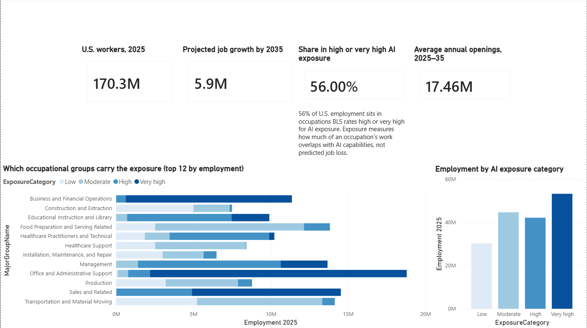
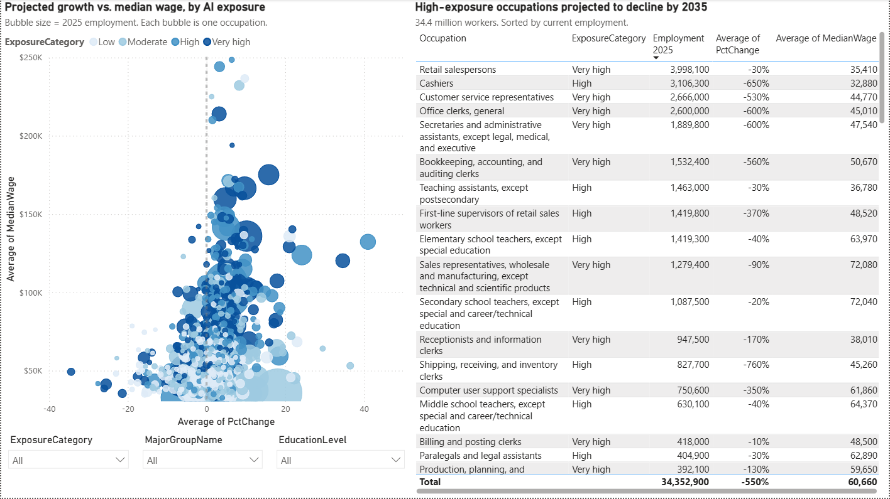
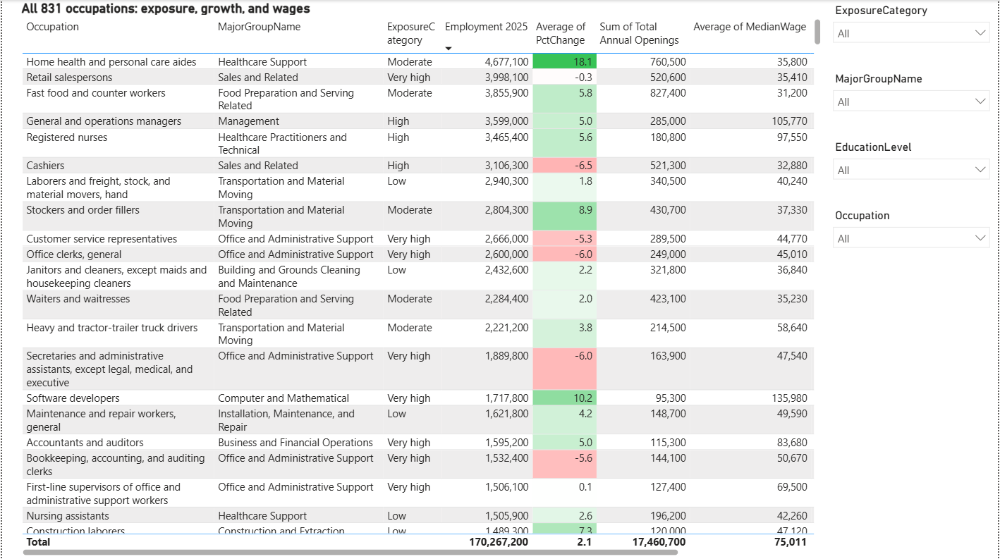

# AI Exposure vs. Projected Employment Change (U.S., 2025–2035)

BLS published its first AI exposure classification for U.S. occupations on August 27, 2026, rating each one Low, Moderate, High, or Very high. This report joins it to the 2025–35 employment projections released at the same time, covering all 831 detailed occupations.

The question: where does high AI exposure line up with projected job decline, and where doesn't it?

Power Query for the transformations, a two-table model, nine DAX measures, three report pages.

---

## Key findings

**1. Exposure is common; projected decline is not.**

56% of U.S. employment (95.4 million workers) is in occupations rated High or Very high. Of those, 34.4 million are in occupations projected to shrink by 2035. The rest are projected to hold steady or grow.

**2. Exposed occupations tend to be bigger.**

| Exposure | Occupations | Employment 2025 | Share | Avg. size |
|---|---|---|---|---|
| Low | 213 | 30,264,700 | 17.8% | 142,100 |
| Moderate | 206 | 44,651,300 | 26.2% | 216,800 |
| High | 206 | 42,142,000 | 24.8% | 204,600 |
| Very high | 206 | 53,209,200 | 31.2% | 258,300 |

**3. Declining high-exposure occupations are mostly office and admin work.**

| Occupation | Exposure | Employment | Projected change |
|---|---|---|---|
| Retail salespersons | Very high | 3,998,100 | −0.3% |
| Cashiers | High | 3,106,300 | −6.5% |
| Customer service representatives | Very high | 2,666,000 | −5.3% |
| Office clerks, general | Very high | 2,600,000 | −6.0% |
| Secretaries and administrative assistants | Very high | 1,889,800 | −6.0% |
| Bookkeeping, accounting, and auditing clerks | Very high | 1,532,400 | −5.6% |

The largest growing occupations, by contrast:

| Occupation | Exposure | Employment | Projected change |
|---|---|---|---|
| Home health and personal care aides | Moderate | 4,677,100 | +18.1% |
| Fast food and counter workers | Moderate | 3,855,900 | +5.8% |
| Nursing assistants | Low | 1,505,900 | +2.6% |
| Construction laborers | Low | 1,489,300 | +7.3% |

**4. High exposure doesn't mean decline.**

- Software developers — Very high, 1,717,800 workers, +10.2%
- Data scientists — Very high, 275,600 workers, +34.6%
- Nurse practitioners — High, 336,300 workers, +41.0%

**5. Annual openings are far larger than net growth.**

Net growth over the decade is 5.9 million jobs. Average annual openings are 17.5 million, because most hiring replaces people leaving an occupation. A shrinking occupation can still have plenty of openings.

---

## Data source

| File | Source | Vintage |
|---|---|---|
| `ai-exposure-categories.xlsx` | [BLS AI exposure categories](https://www.bls.gov/emp/publications/ai-exposure-categories.htm) | Published Aug 27, 2026 |

A U.S. federal government work, public domain. One file, keyed to 6-digit 2018 SOC codes, holding exposure category, 2025 and 2035 employment, numeric and percent change, annual openings, median wage, percent self-employed, entry education, work experience, and on-the-job training.

### How BLS built the exposure measure

Five external sources — three theoretical, two based on observed AI usage:

- Felten, Raj & Seamans (AI capability / occupational ability overlap, 2020)
- Eloundou, Manning, Mishkin & Rock (LLM task-time reduction, 2023)
- Eisfeldt, Schubert, Taska & Zhang (LLM task exposure, 2023)
- Massenkoff & McCrory / Anthropic (observed Claude usage mapped to O\*NET tasks, 2025)
- Tomlinson, Jaffe, Wang, Counts & Suri / Microsoft (observed Copilot usage mapped to work activities, 2024–25)

Each was converted to a percentile rank, reduced to two dimensions (median theoretical rank, median observed rank), then clustered into the four categories.

---

## Data preparation

All in Power Query.

1. **Disabled automatic type detection** (File → Options → Data Load, both GLOBAL and CURRENT FILE). Left on, it types the wage column before the suppression markers are removed, turning them into errors that can't be fixed afterward.
2. **Removed the title row**, promoted headers.
3. **Dropped footnote rows** by filtering nulls in the SOC code column. Remove Bottom Rows would delete real data if BLS adds a note later. 836 → 831 rows.
4. **Checked for aggregate rows.** BLS files often mix group totals (`43-0000`) with detail rows (`43-4051`), which double-counts. Landing on exactly 831 confirmed there were none.
5. **Replaced `—` with null**, using Match entire cell contents, before any type conversion. That's how BLS marks unavailable values.
6. **Multiplied employment by 1,000.** BLS publishes in thousands. Applied to `Emp2025`, `Emp2035`, `EmpChange`, `AnnualOpenings` only.
7. **Added `ExposureSortOrder`** (Low=1 … Very high=4), then set `ExposureCategory` to Sort by Column. Otherwise visuals sort alphabetically.
8. **Extracted `MajorGroupCode`** from the first two characters of the SOC code, kept as text.
9. **Set all types explicitly**, last.

### Validation checks

| Check | Expected | Result |
|---|---|---|
| Row count | 831 detailed occupations | 831 |
| SOC codes distinct / unique | 831 / 831 | pass |
| Exposure categories | 4 | 4 |
| Major groups | 22 (55 Military Specific excluded by BLS) | 22 |
| Total employment 2025 | ~170M | 170,267,200 |
| Net projected change | BLS headline 5.9M | 5,917,300 |
| Errors in any column | 0% | 0% |

`MedianWage` has 6 nulls out of 831. Those rows stay in the model — dropping them would pull their employment out of every total to fix a gap in one column. The weighted wage measure filters them out internally instead.

### External validation

Checked against BLS's published aggregates in *The Economics Daily*, ["Total employment projected to grow 3.5 percent between 2025 and 2035"](https://www.bls.gov/opub/ted/2026/total-employment-projected-to-grow-3-5-percent-between-2025-and-2035.htm) (September 21, 2026). All 22 major groups match within rounding. A sample:

| Major group | BLS published | This model |
|---|---|---|
| Healthcare support | 1,122,700 / +13.3% | 1,123,000 / +13.3% |
| Healthcare practitioners and technical | 819,500 / +8.0% | 819,500 / +8.0% |
| Management | 844,200 / +6.2% | 843,800 / +6.2% |
| Business and financial operations | 628,600 / +5.5% | 628,500 / +5.5% |
| Computer and mathematical | 403,100 / +7.3% | 402,700 / +7.3% |
| Construction and extraction | 385,700 / +5.1% | 385,500 / +5.1% |
| Life, physical, and social science | 122,900 / +7.5% | 123,300 / +7.5% |
| Office and administrative support | −752,200 / −4.0% | −752,200 / −4.0% |
| Economy-wide total | 5.9M / +3.5% | 5,917,300 / +3.5% |

Differences of a few hundred jobs come from BLS publishing in thousands to one decimal.

---

## Data model

```
MajorGroups (22 rows)          Projections (831 rows)
  MajorGroupCode  ──1────*──►    MajorGroupCode
  MajorGroupName                 SOC, Occupation
                                 Emp2025, Emp2035, EmpChange
                                 PctChange, AnnualOpenings
                                 MedianWage, ExposureCategory
                                 EducationLevel, WorkExperience, OnJobTraining
```

Single-direction one-to-many. `MajorGroups` is a hand-entered lookup so visuals show "Office and Administrative Support" rather than `43`.

---

## Measures

```dax
Employment 2025 = SUM(Projections[Emp2025])

Employment 2035 = SUM(Projections[Emp2035])

Projected Change = [Employment 2035] - [Employment 2025]

Projected Growth % = DIVIDE([Projected Change], [Employment 2025])

Occupation Count = COUNTROWS(Projections)

Total Annual Openings = SUM(Projections[AnnualOpenings])

Employment in High Exposure =
CALCULATE(
    [Employment 2025],
    Projections[ExposureCategory] IN { "High", "Very high" }
)

Share in High Exposure =
DIVIDE([Employment in High Exposure], [Employment 2025])

Share of Total Employment =
DIVIDE(
    [Employment 2025],
    CALCULATE([Employment 2025], ALL(Projections))
)
```

```dax
Employment-Weighted Average Wage =
VAR WagedRows =
    FILTER(Projections, NOT ISBLANK(Projections[MedianWage]))
RETURN
    DIVIDE(
        SUMX(WagedRows, Projections[Emp2025] * Projections[MedianWage]),
        SUMX(WagedRows, Projections[Emp2025])
    )
```

`AVERAGE(MedianWage)` would weight a 3,000-person occupation the same as a 3-million-person one, so this weights by employment. Filtering inside the measure keeps the six wage-suppressed occupations out of this calculation without removing them from employment totals.

The name is deliberate: this is a weighted mean of occupation-level medians, not a median of the underlying wage distribution. A true median would need the microdata behind the published figures.

---

## Report pages

### 1. Overview



KPI cards, employment by exposure category, and employment by occupational group with exposure as a stacked legend.

### 2. Exposure vs. Growth



Projected percent change against median wage, bubble-sized by employment, with a constant line at 0% growth. Beside it, the High and Very high occupations projected to decline — the 34.4 million figure.

### 3. Occupation Explorer



All 831 occupations, with slicers on exposure, occupational group, and education, plus search on occupation name. `PctChange` uses a diverging color scale with white at 0%.

Exposure uses a light-to-dark ramp on every page, since the categories are ordered.

---

## Limitations

From the BLS documentation.

**Exposure is not a forecast.** BLS says the categories don't predict employment growth or decline, wages, AI adoption, worker replacement, or productivity.

**Exposure is relative.** The categories rank occupations against each other. "Low" doesn't mean unaffected.

**Automation and augmentation aren't separated.** The classification doesn't distinguish AI that replaces work from AI that helps someone do it.

**The AI capabilities are dated.** The theoretical sources reflect AI as of mid-2023. The observed sources may skew toward early adopters. Most cover language models only.

**Tasks are scored independently.** No source accounts for bottlenecks or how tasks within a job depend on each other.

**Some values are imputed.** 211 of 4,155 occupation-source combinations, affecting 75 occupations.

**Projections cover more than AI.** They factor in demographics, demand, and industry structure. The percent-change figures aren't AI effects.

**Page 3 wages are unweighted.** Use `Employment-Weighted Average Wage` for the weighted figure.

---

## Reproducing this

1. Download the [AI exposure categories file](https://www.bls.gov/emp/ind-occ-matrix/ai-exposure-categories.xlsx), or use the copy in this repo
2. In Power BI Desktop: File → Options → Data Load → untick "Automatically detect column types and headers for unstructured sources" under both GLOBAL and CURRENT FILE
3. Open `ai-exposure-dashboard.pbix` and point the source at your local file path
4. Refresh

Step 2 matters. Skipping it brings back the type-conversion errors.

---

## Files

```
├── README.md
├── ai-exposure-dashboard.pbix      Power BI report
├── ai-exposure-categories.xlsx     Raw BLS source file (public domain)
├── overview.png
├── exposure-vs-growth.png
└── occupation-explorer.png
```

---

*Source: U.S. Bureau of Labor Statistics, Employment Projections program — AI exposure categories and 2025–35 employment projections, published August 27, 2026. Public domain.*
